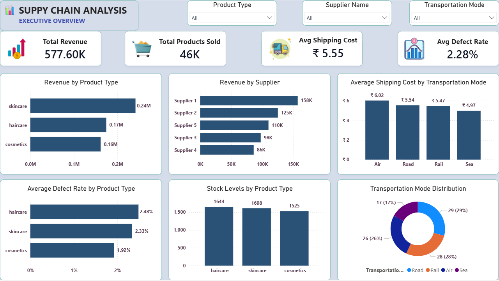
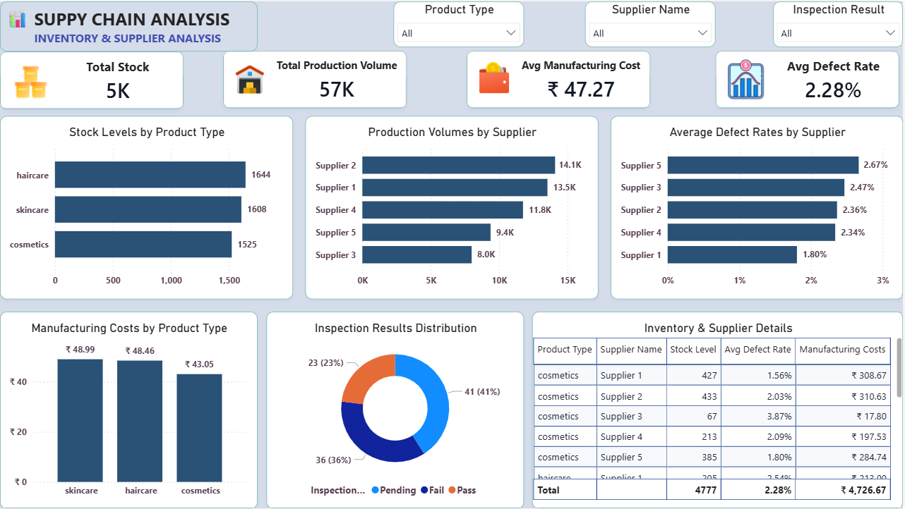
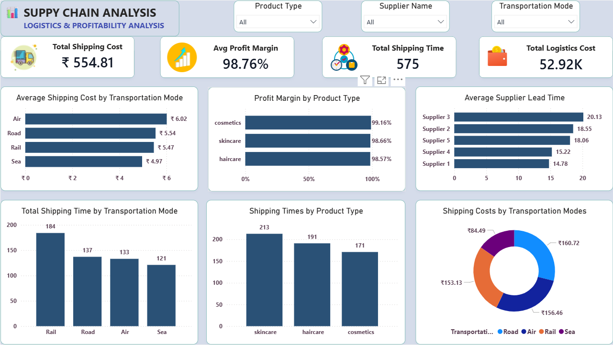
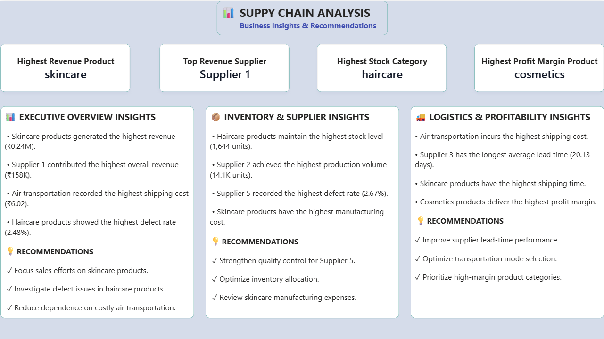

# 🚚 Supply Chain, Inventory & Supplier Quality Optimization



## 📌 Executive Summary & Client Problem Statement

Organizations managing multi-tier supply chains face margin erosion due to **inventory stock-outs on high-velocity SKUs, prolonged supplier lead times, elevated supplier defect rates (driving downstream warranty/replacement costs), and expensive expedited shipping**.

This end-to-end consulting analytics project evaluates **100 SKUs across 24 operational, inventory, supplier quality, and logistics parameters** using **Python, PostgreSQL, Excel, and Power BI**. It diagnoses operational bottlenecks and charts a transformation from a reactive, spreadsheet-driven **As-Is state** to an automated, ERP/BI-integrated **To-Be enterprise environment**.

---

## 🧭 Consulting Framework: As-Is vs. To-Be & Requirement Traceability Matrix (RTM)

### 1. Current State ("As-Is") vs. Future State ("To-Be") Enterprise Workflow
* **As-Is Process (Legacy State):** Siloed procurement, quality inspection, and shipping records across disconnected spreadsheets $\rightarrow$ working capital trapped in low-revenue Class C SKUs (**57.70 mean stock units**) while high-revenue Class A SKUs carry lower buffers (**42.27 mean stock units**) $\rightarrow$ **36% quality inspection failure rate** and over-reliance on expensive Air freight.
* **To-Be Enterprise Process (Recommended):** Automated ingestion of **SAP MM / ERP** inventory and supplier quality logs into **PostgreSQL** $\rightarrow$ **Python** ABC-differentiated Safety Stock and Reorder Point ($ROP$) engine $\rightarrow$ real-time **Power BI** control tower triggering automated purchase requisitions and shifting non-urgent replenishment from Air to Road/Sea.

### 2. Requirement Traceability Matrix (RTM)
| Req ID | Client Business Requirement | Analytical Solution (`Python` / `SQL` / `Power BI`) | Quantified Finding & Strategic Impact |
| :--- | :--- | :--- | :--- |
| **BR-01** | Prevent stock-outs on high-margin SKUs & optimize working capital | ABC revenue segmentation & lead-time adjusted Reorder Point ($ROP = d \times L + SS$) model | **49 Class A SKUs** generate **$403.16k (70% of total revenue)** but hold the lowest mean stock (**42.27 units**); identified **83 SKUs** requiring dynamic ROP buffer realignment. |
| **BR-02** | Reduce supplier defect rates, inspection failures & rework costs | Supplier quality benchmarking & defect rate analysis (`SQL` & `Inventory/Supplier View`) | **Supplier 1** leads in revenue (**$157.53k**) with the lowest defect rate (**1.80%**); **Supplier 5** has the highest mean defect rate (**2.67%**) and **Supplier 4** has the highest inspection fail rate (**12/18 SKUs failed**). |
| **BR-03** | Minimize logistics & expedited shipping expenditure | Multimodal route cost vs. transit-time distribution analysis (`Logistics View`) | **Road** achieves faster mean delivery (**4.72 days**, median cost **$540.13**) than **Air** (**5.12 days**, median cost **$628.29**), enabling immediate mode-shift cost reduction. |
| **BR-04** | Maximize product-line profitability | Category revenue & unit margin decomposition (`Executive Overview`) | **Skincare** drives the highest total revenue (**$241.63k** across 40 SKUs), while **Cosmetics** commands the highest average revenue per SKU (**$6,212.36**). |

---

## 🛠️ Technical Stack & Tools Demonstrated

* **Data Cleaning, Feature Engineering & Inventory Modeling:** Python (`Pandas`, `NumPy`, `Matplotlib`, `Seaborn`)
* **Database & Analytical Querying:** PostgreSQL (`Window Functions`, `RANK / DENSE_RANK`, `CTEs`, `Conditional Aggregations`)
* **Business Intelligence & Visualization:** Microsoft Power BI (`DAX`, `Interactive KPI Views`, `Executive Storytelling`)
* **Consulting Deliverables:** As-Is vs. To-Be Process Mapping, Requirement Traceability Matrix (RTM), ABC-ROP Safety Stock Modeling

---

## 📊 Interactive Power BI Dashboard Modules

### 1️⃣ Executive Overview
Tracks total revenue (**$577.60k**), product category performance, supplier revenue contribution, shipping cost breakdown, and defect rate monitoring.


---

### 2️⃣ Inventory & Supplier Quality Analysis
Monitors SKU stock levels vs. order lead times, production volumes, quality inspection pass/fail distributions (**36 Fail, 41 Pending, 23 Pass**), and supplier-level defect rates.


---

### 3️⃣ Logistics & Profitability Analysis
Evaluates transportation mode economics (**Air, Road, Rail, Sea**), carrier transit times, route cost efficiency, and product-line profit margins.


---

### 4️⃣ Business Insights & Strategic Recommendations
Synthesizes key operational findings and actionable recommendations for procurement, inventory buffering, and carrier routing.


---

## 📈 Summary of Key Analytical Findings

1. **Category Revenue Leadership:** **Skincare** generated the highest total revenue (**$241,628.16** across 20,731 units sold), followed by **Haircare** (**$174,455.39**) and **Cosmetics** (**$161,521.27**).
2. **Supplier Benchmarking:** **Supplier 1** is the top-performing partner (**$157,529.00** revenue, **1.80%** mean defect rate, **14.78-day** mean lead time). Conversely, **Supplier 5** recorded the highest average defect rate (**2.67%**) and **Supplier 4** recorded the highest unit manufacturing cost (**$62.71**) and inspection failure rate (**66.7%**).
3. **Inventory Allocation Imbalance:** Working capital is disproportionately tied up in **Class C SKUs** (averaging **57.70 units** in stock for the bottom 10% of revenue), whereas high-velocity **Class A SKUs** average only **42.27 units** in stock despite a **16.08-day** average lead time.
4. **Logistics Mode Optimization:** **Air freight** incurred the highest average route cost (**$561.71** mean / **$628.29** median) without delivering a transit-time advantage over **Road transport** (**4.72 days** mean shipping time, **$540.13** median cost), while **Sea freight** offered the lowest cost profile (**$417.82** mean / **$323.59** median).

---

## 🔄 End-to-End Project Architecture

```text
Raw Operational & Logistics Data (supply_chain_data.csv)
    ↓
Data Cleaning & Feature Engineering in Python (Profit Margin, Shipping Efficiency, ABC-ROP Model)
    ↓
Processed Dataset (supply_chain_clean_data.csv)
    ↓
Relational Database & KPI Querying in PostgreSQL (supply_chain_analysis.sql)
    ↓
4-Page Interactive Power BI Dashboard (Supply_Chain_Analysis.pbix)
    ↓
Consulting Requirement Traceability Matrix (RTM) & Action Plan
```

---

## 📁 Repository Structure

```text
Supply-Chain-Inventory-and-Operations-Optimization
│
├── Dataset
│   ├── supply_chain_data.csv
│   └── supply_chain_clean_data.csv
│
├── Python
│   └── supply_chain_eda.ipynb
│
├── SQL
│   └── supply_chain_analysis.sql
│
├── Power BI
│   └── Supply_Chain_Analysis.pbix
│
├── Dashboard_Screenshots
│   ├── 1_Executive_Overview.png
│   ├── 2_Inventory_Supplier_Analysis.png
│   ├── 3_Logistics_Profitability_Analysis.png
│   └── 4_Business_Insights.png
│
└── README.md
```

---

## 👤 Author & Attribution

**Hari Keerthan Reddy**  
*B.Tech Mechanical Engineering, Indian Institute of Technology Hyderabad (IIT Hyderabad)*  
**Skills:** Python | SQL (PostgreSQL) | Power BI | Excel | Supply Chain & Operations Analytics

Attribution & Open-Source Compliance:
Base Dataset & Power BI Dashboard Architecture: Adapted from open-source repository Supply-Chain-Analytics-Dashboard (originally authored by Pritam Patil).

Independent Analytical Extensions Developed by Author:

ABC-XYZ Revenue Segmentation & Differentiated Service-Level Safety Stock / Reorder Point (
ROP) Model implemented in Python.

Supplier Quality & Inspection Failure Rate Benchmarking Queries implemented in PostgreSQL.

Accenture Strategy & Consulting As-Is to To-Be Process Mapping & Requirement Traceability Matrix (RTM) framework.

